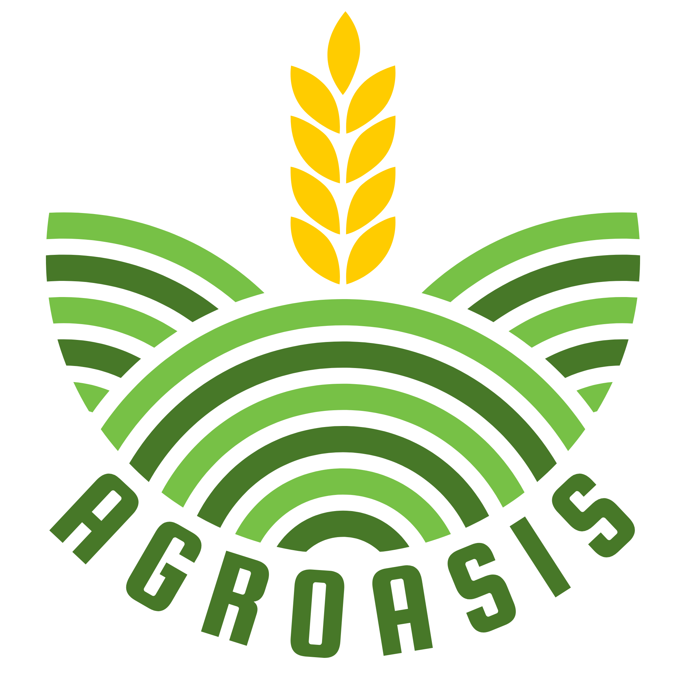

<p align="center">
  
</p>

<h1 align="center">Agroasis</h1>

<p align="center">
  <b>Sistema de recomendación de cultivos y optimización de fertilizante en parcelas agrícolas</b><br>
  Ciencia de Datos para Negocios · Universidad Nacional Rosario Castellanos
</p>

---

## ¿Qué problema resuelve?

Muchos agricultores en México fertilizan "a ojo": aplican de más (gastan dinero y contaminan el suelo y el agua) o de menos (pierden rendimiento). Los análisis de suelo existen, pero interpretarlos requiere conocimiento técnico.

**Agroasis** toma el análisis de suelo de una o varias parcelas y responde tres preguntas:

1. **¿Qué conviene sembrar aquí?** — cultivos más compatibles con ese suelo.
2. **¿Qué le falta al suelo?** — déficit de nutrientes para el cultivo elegido.
3. **¿Cuánto fertilizante aplicar y cuánto cuesta?** — dosis óptima y costo estimado en pesos con fertilizantes del mercado mexicano.

Si el agricultor no tiene análisis de laboratorio, el **modo manual** estima las propiedades del suelo a partir de lo que ha sembrado antes y del tipo de suelo.

## 🌱 Pruébala en línea

**👉 https://rebeca256.github.io/agroasis/web/**

Funciona desde cualquier celular o computadora, sin instalar nada. Todo el análisis (incluido el modelo de Machine Learning) corre **dentro del navegador**: no hay servidor, los datos del agricultor no salen de su dispositivo y, una vez cargada la página, sigue funcionando aunque se caiga el internet.

## La ciencia de datos detrás

| Disciplina | Qué hace en Agroasis | Archivo |
|---|---|---|
| **Machine Learning** | Random Forest (200 árboles) entrenado con 143 registros de cultivos mexicanos (INIFAP) que clasifica los cultivos compatibles con el suelo | `app/models/crop_classifier.py` |
| **Álgebra lineal** | Suelo y cultivo como vectores en R⁵ = [N, P, K, pH, MO]; el déficit es ΔV = V<sub>demanda</sub> − V<sub>suelo</sub> | `app/models/fertilizer_recommender_v2.py` |
| **Cálculo diferencial** | Beneficio neto B(u) = a·ln(u+1) + b − c·u²; la dosis óptima u* sale de B′(u) = 0 | `app/app.py` |
| **Estadística** | Promedio de muestras por parcela, prueba de hipótesis (t de Student / Z) y proyección del suelo a 5 temporadas | `app/app.py`, `app/templates/csv_analisis.html` |

## Contenido del repositorio

```
agroasis/
├── app/            Aplicación original (Python + Flask): modelo, lógica y plantillas
├── web/            Versión que corre en el navegador (generada desde app/)
├── pruebas/        Pruebas de paridad: Flask vs. versión del navegador
├── documento/      Documento del proyecto (LaTeX + PDF)
└── presentacion/   Presentación del proyecto (HTML)
```

- 🌱 [App en línea](https://rebeca256.github.io/agroasis/web/)
- 🎤 [Presentación en línea](https://rebeca256.github.io/agroasis/presentacion/)
- 📄 [Documento del proyecto (PDF)](documento/Prototipico_Agroasis.pdf)
- 📘 [Detalle técnico de la app](app/LEEME.md)

## Cómo ejecutar la app con Python (Flask)

Requisitos: **Python 3.13** y **git**.

```bash
git clone https://github.com/rebeca256/agroasis.git
cd agroasis/app

python -m venv venv
venv\Scripts\activate          # Windows
# source venv/bin/activate     # macOS / Linux

pip install -r requirements.txt
python app.py
```

Abrir en el navegador: **http://127.0.0.1:5000**

> Los modelos de `app/trained_models/` se guardaron con scikit-learn 1.8.0; por eso `requirements.txt` fija esa versión.

### Probarla rápido

- **Modo CSV → botón "CSV de ejemplo"**: analiza `Analisis_VariasParcelas_VariasMUestra.csv` (varias parcelas con varias muestras cada una).
- **Subir un CSV propio** con columnas como las del ejemplo:

```csv
parcela,ph,mo_pct,N_mgkg,P_mgkg,K_mgkg,Ca_mgkg,Mg_mgkg,S_mgkg,Fe_mgkg,Zn_mgkg,Mn_mgkg,Cu_mgkg,B_mgkg,ce_ds_m,textura_suelo,precipitacion_mm,temp_media_c,altitud_msnm
Parcela_A_M1,6.5,2.5,45,15,120,1500,250,25,12,1.5,8,0.8,0.5,0.8,franco,750,22,1500
```

Las muestras se agrupan por parcela según el nombre (`Parcela_A_M1`, `Parcela_A_M2` → `Parcela_A`). Las columnas que falten se rellenan con valores de referencia.

## Versión en el navegador (`web/`)

La carpeta `web/` es la misma aplicación, convertida para correr sin servidor y publicarse en GitHub Pages:

- **Modelo:** los 200 árboles del Random Forest, el `StandardScaler` y el `LabelEncoder` se exportan a JSON (`web/static/data/modelo.json`, ~0.5 MB).
- **Lógica:** `web/static/js/agroasis-engine.js` es una traducción a JavaScript de `app.py`, `models/` y `utils/`. Intercepta las llamadas `fetch("/api/...")` de las páginas y responde lo mismo que respondería Flask, así que las plantillas HTML no cambian.
- **Páginas:** se generan renderizando las plantillas de Flask a HTML estático.

**Si cambian el modelo, los CSV o las plantillas**, regeneren `web/`:

```bash
cd app
venv\Scripts\activate
python build_web.py
```

Si cambian la lógica de Python (`app.py`, `models/`, `utils/`), hay que hacer el mismo cambio en `agroasis-engine.js`.

### Pruebas de paridad

Verifican que la versión del navegador da **exactamente** las mismas respuestas que Flask, con más de 1,000 peticiones (CSV reales y con ruido, varias parcelas, archivos con errores, modo manual y optimización):

```bash
app\venv\Scripts\python pruebas\generar_casos.py   # respuestas de Flask
node pruebas\comparar.js                            # las compara con el motor JS
```

> Cuando dos cultivos tienen **exactamente** la misma probabilidad, NumPy los ordena de forma arbitraria (depende del procesador), así que Flask mismo puede dar un orden distinto en otra computadora. La prueba no cuenta esos empates como diferencia.

## Tecnologías

**Backend:** Python, Flask, pandas, NumPy, scikit-learn
**Versión en el navegador:** JavaScript (motor propio), GitHub Pages
**Frontend:** HTML, CSS, JavaScript, Bootstrap 5, Plotly.js
**Documento:** LaTeX

## Equipo

- Aquino Soto Joshua David
- Felipe Santiago Ithan
- Jaimes Cruz Rebeca
- Romero Morales Ángel Jerath

**Profesores:** Barragán Trinidad Melesio · Castillo Vieyra Ana Karen · Hernández Jiménez Sharon
**Tutoras:** Sierra Hernández María Guadalupe · Hernández Jiménez Sharon

## Uso de IA

En el desarrollo se usó IA generativa como apoyo para escribir y depurar código y para el diseño de la interfaz. Los datos agronómicos, los umbrales del INIFAP, el catálogo de fertilizantes y el dataset de cultivos fueron investigados y curados por el equipo. Ver detalle en [`app/LEEME.md`](app/LEEME.md#declaratoria-de-uso-de-ia).
